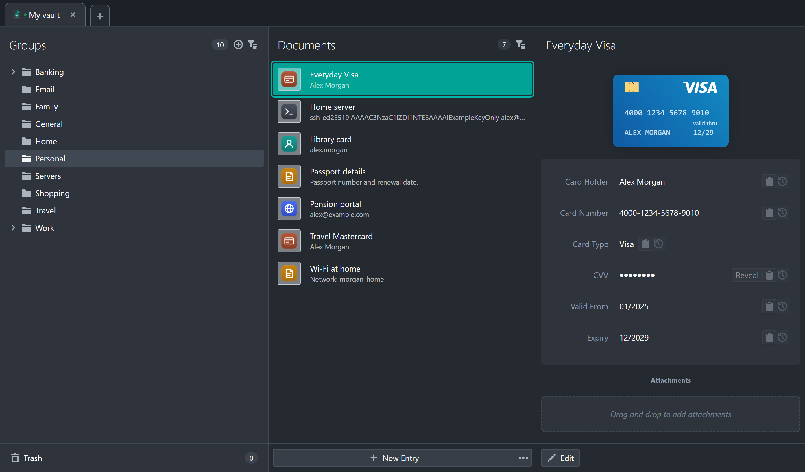

# Buttercup Desktop
> Buttercup for Desktop - Windows and Linux

**3.0.0 / 4.0.0 (2026-11-24) fix security problems in the original Buttercup apps.** What to do: [release notes](https://github.com/buttercup-fork/buttercup-desktop/releases/tag/v3.0.0).

[](https://github.com/buttercup-fork/buttercup-desktop) [](https://github.com/buttercup-fork/buttercup-desktop/releases/latest)



---

ℹ️ **About this fork**

The original [Buttercup password manager](https://github.com/buttercup/buttercup-desktop) was closed by its maintainers and its repositories archived. This is an independent fork, maintained by **CodeKunde** to keep the app working and secure (bug fixes, dependency upgrades, Electron modernization, tooling). See [`CHANGELOG.md`](CHANGELOG.md) for what has changed. In-app update checks read this repository's releases.

This fork is not affiliated with, endorsed by, or supported by the original Buttercup maintainers. It has not yet undergone an independent security audit (this line will be removed once/if one happens).

It depends on the companion fork [`buttercup-fork/buttercup-core`](https://github.com/buttercup-fork/buttercup-core).

---

## About

**New to Buttercup, or moving from the original app?** Read the [user guide](docs/README.md).

Buttercup is a free, open-source and cross-platform **password manager**, built on NodeJS with Typescript. It uses strong industry-standard encryption to protect your passwords and credentials (among other data you store in Buttercup vaults) at rest, within vault files (`.bcup`). Vaults can be loaded from and saved to a number of sources, such as the **local filesystem**, **Dropbox**, **Google Drive** or any **WebDAV**-enabled service (like _ownCloud_ or _Nextcloud_ ¹).

### Known issues

None of these leaks a password to a web page.

 * **Google Drive:** any Google account can sign in. While this fork's Google sign-in app was in Google's *Testing* mode, a sign-in had to be repeated every 7 days; we are still checking that this has stopped, so if Google Drive asks you to sign in again, do so. Google Drive vaults added with a version before the new sign-in ask to sign in once more. Buttercup can only see Drive files it created itself: to open a vault made elsewhere, download it and use **Upload Vault** when adding the Google Drive vault. Local files, Dropbox and WebDAV are unaffected.
 * **Dropbox** sign-in still goes through the original Buttercup project's Dropbox app, and requests to cloud and WebDAV services still name the original project's website as their origin. Both move to this fork's own setup in a later release.
 * **Browser extension:** the in-page menu shows only entries for the site you're on and has no search; search and copy work from the extension's toolbar button. Passwords copied from the extension's popup are not cleared from the clipboard and can end up in clipboard history (copies from this app can be cleared automatically, see [Precautions](#precautions)).
 * An entry for a **shared hosting name** (for example `example-host.org`) is also offered on its users' subdomains (`someone.example-host.org`).
 * **Attachments:** two devices that each add a vault's first attachment before either has synced can leave one device's attachments unreadable. Until this is fixed, add the first attachment on one device and let it sync before adding attachments elsewhere.
 * **Linux:** locking vaults when the screen locks needs the system's `dbus-monitor` (package `dbus-bin`, installed on most desktops). Without it, vaults lock on sleep only, and a warning is logged.

### Why you need a password manager

Password management is a crucial tool when you have _any_ online presence. It's vital that all of your accounts online use strong and unique passwords so that they're much more difficult to break in to. Even if one of your accounts are breached, having unique passwords means that the likelihood of the attacker gaining further access to your accounts portfolio is greatly reduced.

Without a password manager, such as Buttercup, it would be very tedious to manage different passwords for each service. If you remember your passwords it's a good sign that they're not strong enough. Ideally you should memorise a primary password for your vault, and not know any of the account-specific passwords off the top of your head.

### Precautions

Buttercup securely encrypts your data in protected files, but this security is only as strong as the weakest component - and this is very often the primary password used to lock and unlock your vault. Follow these basic guidelines to ensure that your vault is safe even if exposed:

 * Choose a **unique** password that is not used elsewhere
 * Use a highly-varied set of different characters - such as alpha-numeric, symbols and spaces
 * Use a long password - the longer the better
 * Don't include words or names in the password
 * Never share your password with anyone

**Copied passwords and clipboard history:** new installs clear the clipboard 30 seconds after you copy a password (change it in **Preferences → Security → Automatically clear clipboard**). A clipboard history tool, such as Windows clipboard history (Win+V), Flycut, Maccy, Ditto or Klipper, keeps its own copy the moment you copy, and Buttercup can't remove it from there. Turn off the history, or exclude Buttercup in that tool, if you don't want passwords saved in it.

_It is very important to note that no one associated with Buttercup will ever request your personal vault or its primary password. Do not share it or any of its related details with anyone. Developers or contributors working with Buttercup may request **example** vaults created via your system to try and reproduce issues, but please ensure to never use your real password or store actual credentails within such vaults._

### Versions

The current stable version is **3**, the first release of this fork. If you're still on v1 or v2, upgrade: they are no longer maintained. You can still browse the v1 source and documentation [here](https://github.com/buttercup/buttercup-desktop/tree/v1).

The app is built on [Electron](https://www.electronjs.org/) (see `package.json` for the current version) and is built in CI with Node 22 LTS.

### Operating Systems

Builds are provided for:

 * Linux: x64, as an AppImage (runs on most distributions, such as Ubuntu) and a `.deb` package (Debian/Ubuntu)
 * Windows 10 / 11 (x64)

There is no macOS build and no Linux arm64 build in this release: both follow once they have been tested.

All builds are **unsigned** - see [Published Applications](#published-applications).

#### 32bit builds (x86)

This fork does not provide 32bit builds.

## Portability

Buttercup provides a portable **Windows** version. Look for the release asset named like `Buttercup-win-x64-3.0.0-portable.exe`, where `3.0.0` is the version and `x64` is the architecture. It keeps all of its data (vault list, settings, backups, log and the app's own profile) in a **`Buttercup-data`** folder next to the `.exe`. On its first start it copies the vault list and settings from the standard locations (see [Configuration](#configuration)), so vaults you already use are still listed; the originals are left in place.

Although not explicitly portable, the Linux **AppImage** is more or less standalone. It still writes to the standard config/log destinations, however.

To put the data somewhere else (for the portable build or any other), set some environment variables:

| Environment Variable   | Description |
|------------------------|-------------|
| `BUTTERCUP_HOME_DIR`   | If provided, Buttercup keeps its data, configuration, cache, log and temporary files under this path (in `data`, `config`, `cache`, `log` and `temp` sub-folders). |
| `BUTTERCUP_CONFIG_DIR` | Optional. Stores user settings (in a `config` sub-folder) here instead of under `BUTTERCUP_HOME_DIR`. Only takes effect if `BUTTERCUP_HOME_DIR` is provided. |
| `BUTTERCUP_TEMP_DIR`   | Optional. Stores temporary files (in a `temp` sub-folder) here instead of under `BUTTERCUP_HOME_DIR`. Only takes effect if `BUTTERCUP_HOME_DIR` is provided. |

### Sample `ButtercupLauncher.bat` for Windows portable executable

> This example stores user settings and cache in a folder next to the launcher, but stores temporary files on the host PC. Change the executable's file name to match the version you downloaded.

```bat
@ECHO OFF
if not exist "%~dp0Buttercup" mkdir "%~dp0Buttercup"
set "BUTTERCUP_HOME_DIR=%~dp0Buttercup"
set "BUTTERCUP_TEMP_DIR=%temp%"
start "" "%~dp0Buttercup-win-x64-3.0.0-portable.exe" %*
```

## Configuration

Configuration files are stored in OS-specific locations (unless `BUTTERCUP_HOME_DIR` is set - see [Portability](#portability)). Note the `Buttercup-nodejs` folder name.

### Command-Line arguments

The following arguments can be provided to Buttercup, but are all optional.

| Argument              | Description                           |
|-----------------------|---------------------------------------|
| `--autostart`         | Flag passed to Buttercup when launched automatically by the OS. |
| `--hidden`            | Disables the automatic opening of the main window upon launch. |
| `--no-update`         | Disables automatic update checking. **Not recommended**: Use at your own risk. |

### App config

Application configuration.

 * Linux: `$XDG_CONFIG_HOME/Buttercup-nodejs/desktop.config.json` (`~/.config` if `XDG_CONFIG_HOME` is unset)
 * Mac: `~/Library/Preferences/Buttercup-nodejs/desktop.config.json`
 * Windows: `%APPDATA%\Buttercup-nodejs\Config\desktop.config.json`

### Vault storage

Storage of connected vaults (not actual vault contents).

 * Linux: `$XDG_DATA_HOME/Buttercup-nodejs/vaults.json` (`~/.local/share` if `XDG_DATA_HOME` is unset)
 * Mac: `~/Library/Application Support/Buttercup-nodejs/vaults.json`
 * Windows: `%LOCALAPPDATA%\Buttercup-nodejs\Data\vaults.json`

### Offline vault cache

Stored copies of vaults for offline use, in your OS's temporary directory (`os.tmpdir()`).

 * Linux: `<tmpdir>/<username>/Buttercup-nodejs/vaults-offline.cache.json`
 * Mac: `<tmpdir>/Buttercup-nodejs/vaults-offline.cache.json`
 * Windows: `<tmpdir>\Buttercup-nodejs\vaults-offline.cache.json`

### Logs

Logs are written for all app sessions, to `buttercup-desktop.log` in:

 * Linux: `~/.local/state/Buttercup-nodejs` or `$XDG_STATE_HOME/Buttercup-nodejs`
 * Mac: `~/Library/Logs/Buttercup-nodejs`
 * Windows: `%LOCALAPPDATA%\Buttercup-nodejs\Log`

_The portable Windows app writes its log to `Buttercup-data\log`, next to the executable._

## Published Applications

You can view the current releases on the [releases page](https://github.com/buttercup-fork/buttercup-desktop/releases). Under each release are the binaries and installers for each supported platform. Make sure to pick the right operating system and architecture for your machine:

| Platform | Assets |
|----------|--------|
| Windows (x64) | `Buttercup-win-x64-<version>-installer.exe` (installer), `Buttercup-win-x64-<version>-portable.exe` (portable), `Buttercup-win-x64-<version>.7z` (archive) |
| Linux, x64 | `Buttercup-linux-x86_64.AppImage`, `Buttercup-linux-amd64.deb` (Debian/Ubuntu) |

**These builds are not code-signed**, so your OS will warn you the first time you run them:

 * **Windows** SmartScreen: choose _More info_, then _Run anyway_.

### Linux

We provide an **AppImage** build for Linux, and a **`.deb`** package for Debian, Ubuntu and derivatives, installed with `sudo apt install ./Buttercup-linux-amd64.deb`. Neither updates itself (no build of this fork does, as releases aren't code-signed): to update, download the new release from the releases page and replace the AppImage, or install the new `.deb` over the old one. Other package formats (rpm, Snap) are not provided at this time.

The `.deb` installs its own menu entry and URL-scheme handler. The AppImage registers its own `.desktop` entry and URL-scheme handler when run, so no extra tooling is required. Installing [**AppImageLauncher**](https://github.com/TheAssassin/AppImageLauncher#readme) is still a good way to integrate AppImages into your desktop (menu entries, icons, updates) if you'd like that.

**Sandbox on Ubuntu 24.04 and later:** these releases restrict the unprivileged user namespaces that Chromium's sandbox (the one Electron uses) relies on. The `.deb` installs an AppArmor profile (`/etc/apparmor.d/buttercup`) that allows them, so it runs with the sandbox. The AppImage cannot install such a profile, so its launcher starts Buttercup with `--no-sandbox` when user namespaces are blocked, rather than failing with a sandbox error (upstream [#1355](https://github.com/buttercup/buttercup-desktop/issues/1355)). Buttercup notes this in its log ("Running without the Chromium sandbox"). On these systems we recommend the `.deb`.

## Development

You need **Node 22 or greater** with **npm 9 or greater**. No IDE is required — any editor works (VS Code is convenient; see [`e2e/README.md`](e2e/README.md) for its optional Playwright extension).

Once cloned, install dependencies with `npm install`. This also builds the `buttercup-core` fork (pulled straight from git), so the first install takes a little longer.

Then, in two terminals:

```bash
npm run start:build     # webpack, development mode, watches for changes
npm run start:main      # launches Electron once build/ exists (Ctrl+R reloads the UI)
```

### Running alongside an installed Buttercup

If you use Buttercup on the same machine, run the dev build isolated so it never reads or writes your real config, vault list or logs:

```bash
npm run start:isolated  # uses a throwaway data dir under your temp folder
```

### Tests

```bash
npm run test:specs      # Jest unit tests (source/**/*.test.ts)
npm run test:e2e         # Playwright end-to-end UI tests — builds first, then runs
npm run test:e2e:ui      # ...same, in Playwright's interactive runner
npm test                 # build + unit specs + prettier check (what CI runs)
```

The e2e tests launch the real app in an isolated data directory. See [`e2e/README.md`](e2e/README.md).

### Dependency security

The production `npm audit` (`npm audit --omit=dev`, checked 2026-11-24) lists two findings, neither reached by the app: `zod` (fixed only in zod 4; the browser access API caps request bodies at 100 KB) and `i18next` (fixed only in i18next 26; the affected code merges translations added while the app runs, which it never does). Both upgrades are planned. The importer comes from the CodeKunde fork, which fixed the `csv-parse` and `xml2js` findings. Other transitive packages that upstream never patched are pinned in the `overrides` block of `package.json` — check there first if an `npm update` reintroduces a finding.

## Building & Releasing

Two GitHub Actions workflows live in `.github/workflows/`:

 * **`test.yml`** runs on every push and on pull requests to `master`: a build plus the unit tests and prettier check on Ubuntu, macOS and Windows, and an informational Playwright end-to-end run.
 * **`build.yml`** runs on pushes to `master`, on `v*` tags, and on demand: it builds **unsigned** installers on Windows and Linux (no macOS build until macOS releases are tested again). On a `v*` tag it also **drafts a GitHub release** with all of the artifacts (including the `latest*.yml` auto-update metadata) attached.

### Local, unsigned builds

To produce installers for the platform you are on:

```bash
npm run package:win     # dist/*.exe, *.7z, portable  (run on Windows)
npm run package:mac     # dist/*.dmg, *.zip           (run on macOS)
npm run package:linux   # dist/*.AppImage, *.deb      (run on Linux)
```

Each platform's installers must be built on that platform (macOS builds in particular cannot be produced or signed elsewhere). Run `npm run build` first if `build/` is stale. Output lands in `dist/`. These builds are **not code-signed**, so Windows SmartScreen and macOS Gatekeeper will warn on first run.

### Publishing a release

 1. Bump `version` in `package.json` (and the two version fields in `package-lock.json`), run `npm run set-version` (it writes the version into `source/main/library/build.ts`), and add the release to `CHANGELOG.md`.
 2. Merge that to `master`, then tag it `v<version>` and push the tag (`git tag -a v3.0.0 -m "..." && git push origin refs/tags/v3.0.0`).
 3. The `Build` workflow builds everything and drafts the release. Review the draft and publish it by hand.

`build.publish` in `package.json` targets `buttercup-fork/buttercup-desktop`, which is also where the in-app update check looks for new versions. Releases aren't code-signed (D-017), so the app only tells the user a new version exists and opens the releases page; it doesn't download or install anything itself.

For **signed** releases there is `npm run publish` (see `resources/scripts/publish.js`): it builds all three platforms, code-signs them (Windows via a YubiKey — `WIN_YUBIKEY_PIN`; macOS via Apple notarization — `APPLE_ID`, `APPLE_APP_SPECIFIC_PASSWORD`, `APPLE_TEAM_ID`), and uploads the artifacts plus the `latest*.yml` auto-update metadata to a GitHub release via `electron-builder` (`GH_TOKEN` required). It only completes on macOS and needs all of those secrets set. The secrets are not currently configured, so releases are unsigned.

### Verifying downloads

Each release has a `SHA256SUMS.txt` listing the SHA-256 hash of every installer, and a `build-info-<os>.txt` per platform with the commit, runner, Node, npm, Electron and electron-builder versions that built it. Check a download against it:

```bash
sha256sum -c SHA256SUMS.txt --ignore-missing     # Linux
shasum -a 256 -c SHA256SUMS.txt --ignore-missing # macOS
```

```powershell
Get-FileHash .\Buttercup-win-x64-<version>-installer.exe -Algorithm SHA256   # Windows: compare with its line in SHA256SUMS.txt
```

The checksums show a file is the one the release workflow built; they don't make builds reproducible. Building the same commit yourself gives working installers with different hashes (timestamps and packaging metadata differ), as upstream [#1193](https://github.com/buttercup/buttercup-desktop/issues/1193) found. To get close to the release environment, use the Node version in `.nvmrc` and `npm ci`. Run `npm run checksums -- dist dist` after a local build to hash your own installers.

### Contributing

There are a number of ways you can contribute to Buttercup!

#### Features & Bug fixes

Pull requests and issues that make Buttercup better are welcome on this repository (issues and PRs on the original, archived project will not be seen). Please be respectful with your ideas and observations, and consider opening an issue before starting on a substantial pull request.

#### Translations

Buttercup relies on the community for translating its interfaces into languages besides English. English (`en.json`) is the base language, and all others are contributed translations.

To add support for a language, follow these instructions to add another language to the desktop application:

 * Copy the `source/shared/i18n/translations/en.json` file to the language code you're providing (eg. `fi.json` for Finnish).
 * Edit the `source/shared/i18n/translations/index.ts` file and:
   * Import the new JSON file: `import fi from "./fi.json";`.
   * Export the imported constant inside the default export already in that file.

## Notes and Caveats

 * ¹ External services like Nextcloud and ownCloud must be configured correctly to support access via the web (using WebDAV). CORS must permit access from any source.
 * ² Buttercup (including MadDev Oy) is not affiliated with any of the companies represented in screenshots or preview images.
